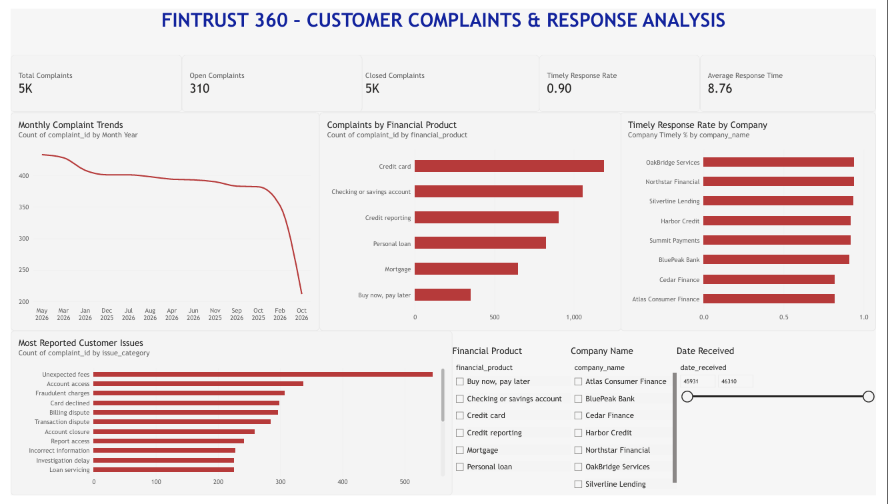

# FinTrust 360 – Financial Customer Complaints & Response Analytics

## Project Description
FinTrust 360 is a data analytics project that analyses customer complaints in the financial services industry. It identifies common customer issues, compares complaints across financial products and evaluates company response performance.

## Tools Used
- **Microsoft Excel:** Data cleaning and analysis
- **SQL:** Data querying and analysis
- **Power BI:** Interactive dashboard and visualisation

## Project Structure
- `01_Excel` – Cleaned dataset and Excel analysis
- `02_SQL` – SQL queries used for analysis
- `03_PowerBI` – Power BI dashboard and screenshot
- `04_Documentation` – Business analysis report

## Key Performance Indicators
- Total Complaints
- Open Complaints
- Closed Complaints
- Timely Response Rate
- Average Response Time

## Dashboard Visualisations
- Monthly Complaint Trends
- Complaints by Financial Product
- Most Reported Customer Issues
- Timely Response Rate by Company

## Project Outcome
The project provides insights into customer complaint patterns and company response performance. It also suggests improvements to complaint handling and customer service.

## Author
Created as a data analytics project.
